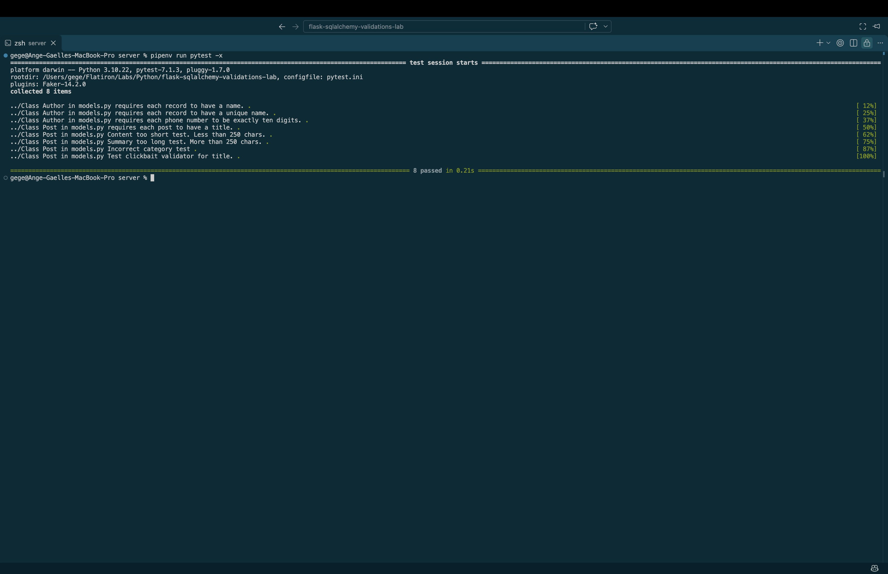

# Flask SQLAlchemy Validations Lab

## Description

This project demonstrates how to implement model-level validations in a Flask application using Flask-SQLAlchemy and SQLAlchemy's `@validates` decorator.

The application includes two database models, `Author` and `Post`, with validation rules designed to prevent invalid data from being stored.

## Technologies Used

- Python 3.10
- Flask
- Flask-SQLAlchemy
- Flask-Migrate
- SQLAlchemy
- SQLite
- Pipenv
- Pytest

## Project Structure

```text
flask-sqlalchemy-validations-lab/
├── server/
│   ├── app.py
│   ├── models.py
│   ├── seed.py
│   └── migrations/
├── testing/
│   └── models_test.py
├── Pipfile
├── Pipfile.lock
└── README.md
```

## Installation and Setup

### 1. Clone the Repository

```bash
git clone git@github.com:a-gbatie/flask-sqlalchemy-validations-lab.git
cd flask-sqlalchemy-validations-lab
```

### 2. Install Dependencies

```bash
pipenv install
```

### 3. Apply Database Migrations

```bash
cd server
pipenv run flask db upgrade
```

### 4. Seed the Database

```bash
pipenv run python seed.py
```

## Models and Validations

### Author Model

The `Author` model stores information about authors.

**Fields:**

- `id`: Unique identifier
- `name`: Author's name
- `phone_number`: Author's phone number
- `created_at`: Creation timestamp
- `updated_at`: Last update timestamp

**Validation Rules:**

1. Every author must have a nonempty name.
2. Author names must be unique.
3. Phone numbers must contain exactly 10 digits.

### Post Model

The `Post` model stores information about posts.

**Fields:**

- `id`: Unique identifier
- `title`: Post title
- `content`: Post content
- `category`: Post category
- `summary`: Post summary
- `created_at`: Creation timestamp
- `updated_at`: Last update timestamp

**Validation Rules:**

1. Post content must contain at least 250 characters.
2. Post summaries must contain no more than 250 characters.
3. Post categories must be either `Fiction` or `Non-Fiction`.
4. Post titles must contain at least one of the following phrases:
   - `Won't Believe`
   - `Secret`
   - `Top`
   - `Guess`

## Testing

This project uses Pytest to verify that model validations work correctly.

Run the tests from the project's root directory:

```bash
pipenv run pytest -x
```

### Test Results

The tests verify that:

- Authors must have valid names.
- Author names must be unique.
- Phone numbers must contain exactly 10 digits.
- Post content meets the minimum length requirement.
- Post summaries do not exceed the maximum length.
- Post categories contain valid values.
- Post titles contain the required keywords.

## Screenshot of Completed Tests


